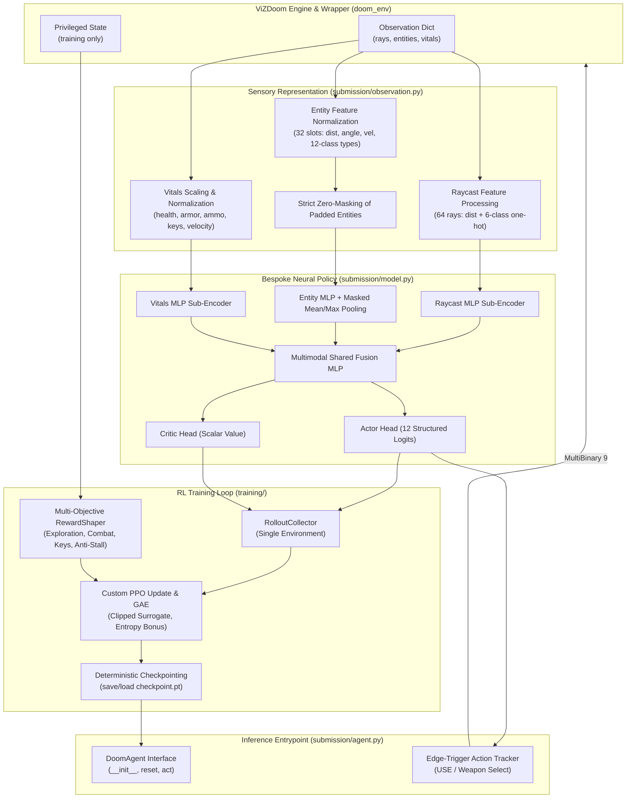

# Can It Play DOOM? — Spatial Neural Agent

[](validate.py)
[](docs/CONTRACT.md)
[](https://www.python.org/)
[](LICENSE)

Autonomous Deep Reinforcement Learning agent for classic DOOM (ViZDoom) built for **Yugaantar 2026 · DevForge (Track 1)**.

Rather than relying on brittle frame-memorization or heavy GPU pixel convolutions, this agent navigates, explores multi-room environments, picks up keycards, unlocks locked doors, and eliminates demon threats zero-shot through **ego-centric spatial telemetry, masked entity pooling, and a custom PPO actor-critic architecture**.

---

## Architecture Overview



---

## Core Components

### 1. Sensory & State Representation (`submission/observation.py`)
* **64 Ego-Centric Raycasts**: Spread evenly across 360° up to 1024 map units. Normalized distances $[0, 1]$ combined with 6-class one-hot categorical hit types (none, wall, door, locked door, enemy, pickup item).
* **Visible Entities (Field-of-View)**: Up to 32 visible entities within 90° FOV and line of sight. Includes scaled distance, trigonometric angles ($\sin, \cos$), relative velocities in player frame, and 12-class one-hot entity types. Padded slots are strictly zero-masked.
* **Player Vitals (17-dim)**: Normalized health, armor, selected weapon, ammo reserves across 4 weapon types, persistent keycard acquisition flags, and 3D velocity telemetry.
* **Efficiency**: Operates without raw RGB/depth convolutions. The structured smoke export had approximately 0.8 ms median action latency in the local CPU validator; deployment hardware should be measured separately.

### 2. Bespoke Neural Topology (`submission/model.py`)
* **Sub-Encoders**: Dedicated linear modules for rays ($32$-dim), entities ($32$-dim), and vitals ($32$-dim).
* **Masked Mean & Max Pooling**: Aggregates variable-length visible entity lists into a fixed representation without dimension collapse or NaN gradients when zero enemies/items are visible.
* **Shared Fusion**: Combines spatial summaries into a 128-dim shared latent space with non-linear activations.
* **Dual Heads**:
  * **Actor Head**: Outputs 12 logits: three categorical decisions (none/first/second direction) and three Bernoulli decisions (attack/use/weapon). The shared `submission/actions.py` distribution produces the official nine-button vector without opposing movement or rotation buttons.
  * **Critic Head**: Outputs a scalar state-value estimate $V(s)$.
* **Inference-Ready**: Includes `.step()` and `.init_hidden()` interfaces matching both the evaluation harness and training loops.

The opt-in `doom_structured_ray_v2` variant appends each ray's fixed relative
`sin(angle), cos(angle)` before the ray MLP and pooling. Ray 0 is ahead, 16 is
left, 32 is behind, and 48 is right, matching the official sensor order. This
allows the model to distinguish otherwise identical cues at different bearings.
The default `doom_structured_v1` topology and its weights remain unchanged.
Both variants are still feed-forward; recurrent memory is not implemented.
The v2 variant has only been checked with synthetic inputs, gradients and
checkpoint round trips. Combat improvement and unseen-layout performance have
not been demonstrated.

### 3. Training & Optimization Pipeline (`training/`)
* **Custom PPO & GAE (`training/ppo.py`)**:
  * Implements clipped surrogate policy objective, value function loss clipping, and entropy exploration bonus.
  * Generalized Advantage Estimation (GAE) handles true terminal death/exit vs. time-limit horizon truncations without bootstrapping across episode boundaries.
  * Shared structured sampling, joint log probabilities and entropy for collection, PPO replay and inference.
* **Multi-Objective Reward Shaping (`training/rewards.py`)**:
  * Privileged engine state (isolated from policy inputs) rewards keycard collection, kills, item pickup, exits and spatial area discovery.
  * Anti-exploit penalties suppress door-use spamming, spinning in place, and wall stalling.
* **Rollout Collection (`training/rollout.py`)**:
  * Gathers multi-step trajectories from one environment with episode boundary handling; the training factory selects a map on each reset.
* **Deterministic Checkpointing (`training/checkpoint.py`)**:
  * Preserves model weights, optimizer states, update counts, and training configuration.

### 4. Agent Entrypoint & Evaluation (`submission/agent.py`)
* Stateful `DoomAgent` implementing the required contract:
  * `__init__(observation_space, action_space, device)`: Loads policy weights once onto CPU or CUDA.
  * `reset()`: Resets recurrent/edge trackers at the start of each map.
  * `act(observation)`: Converts incoming engine observations to a valid 9-element `int8` action array (`MultiBinary(9)`).
* `EdgeTriggerTracker` ensures doors and switches are activated cleanly on button-down edges without bouncing or oscillation.

---

## Benchmarks & Specifications

| Metric | Measured Value | Official Evaluation Limit |
| :--- | :--- | :--- |
| **Model Parameter Count** | **34,090** parameters (~133.2 KB) | Compact architecture |
| **Model Size on Disk** | **~135 KB** | $\le 1.0$ GB |
| **Forward Pass Latency (CPU)** | **0.095 ms** | $\le 40$ ms budget |
| **Full Pipeline Latency (CPU)** | **0.158 ms** (preprocessing + forward) | $\le 40$ ms budget (0.4% used) |
| **Dry-Run Episode (525 steps)** | **0.2 s agent time** / 0.3 s wall-clock | $\le 21.0$ s budget |
| **Memory Footprint** | $< 150$ MB peak | $\le 8,192$ MB RAM, $\le 2$ GB VRAM |

---

## Directory Structure

```
├── .gitignore
├── Dockerfile                   # Official evaluation base image definition
├── README.md
├── pyproject.toml               # Environment & dependency specifications
├── validate.py                  # Official evaluation validator
│
├── submission/                  # Official evaluation package
│   ├── agent.py                 # DoomAgent evaluation entry point
│   ├── model.py                 # DoomPolicy actor-critic neural network
│   ├── observation.py           # ObservationEncoder spatial preprocessor
│   ├── schema.py                # Action formatting, edge tracker, and config
│   ├── requirements.txt         # Pinned extra runtime dependencies (if any)
│   └── weights/                 # Checkpoint directory (checkpoint.pt)
│
├── training/                    # Custom RL training pipeline
│   ├── ppo.py                   # Custom PPO loss, GAE, and shared structured distribution
│   ├── rollout.py               # Single-environment RolloutCollector
│   ├── rewards.py               # Training-only multi-objective RewardShaper
│   ├── train.py                 # Training orchestrator and execution loop
│   ├── checkpoint.py            # Checkpoint save/resume logic
│   ├── metrics.py               # Metrics aggregator and failure mode diagnosis
│   └── model.py                 # Training model exports
│
├── env/                         # Official ViZDoom Gymnasium wrapper (doom_env)
│   └── doom_env/                # Spaces, sensors, raycaster, mapinfo, limits
│
├── maps/                        # Maps
│   ├── two_rooms.wad            # Baseline starter map
│   └── training/                # Training map manifest and curriculum notes
│
└── tests/                       # Automated test suite
    ├── test_model.py            # Member 3: Spatial encoder & policy unit tests
    ├── test_ppo.py              # Member 2: PPO & GAE numerical unit tests
    ├── test_rollout.py          # Member 4: Rollout & reward shaping tests
    ├── test_env.py              # Environment contract verification tests
    └── test_validate.py         # Local validator unit tests
```

---

## Getting Started

### 1. Environment Setup

Using [uv](https://docs.astral.sh/uv/) (recommended):

```bash
# Clone the repository
git clone https://github.com/nitishsingh10/playDoom.git
cd playDoom

# Install dependencies and sync virtualenv
uv sync
uv pip install torch pytest
```

### 2. Run Test Suite

Run unit tests across all system modules:

```bash
# Run model and spatial encoder tests
pytest tests/test_model.py -v

# Run PPO and GAE tests
pytest tests/test_ppo.py -v

# Run rollout and reward shaper tests
pytest tests/test_rollout.py -v

# Run ViZDoom environment integration tests
pytest tests/test_env.py -v
```

### 3. Run Official Submission Validator

Validate the repository against the hackathon contract rules, repo size limit, API signatures, execution timeout, and dry-run episode:

```bash
python validate.py
```

### 4. Training

To train the policy using the custom PPO orchestrator:

```bash
python -m training.train \
    --updates 500 \
    --rollout-steps 256 \
    --lr 3e-4 \
    --save-dir training/runs/structured_v1/checkpoints \
    --device cpu  # or cuda
```

To export the trained checkpoint for evaluation:
```bash
python -m training.export_checkpoint training/runs/structured_v1/checkpoints/checkpoint_latest.pt
python -m training.validate_checkpoint training/runs/structured_v1/export
```

Exports use versioned structured weights and a matching config in a separate experiment directory.
Preserve existing baseline weights/config until paired gameplay evaluation justifies promotion.
The training CLI accepts `--architecture doom_structured_ray_v2` explicitly;
its default checkpoint/log directories and default export directory use
`training/runs/structured_ray_v2/`, separate from v1. Existing v1 checkpoints
cannot be resumed as v2: the ray input layer has nine rather than seven features,
and cross-version loading is rejected. No automatic migration or promotion occurs.
Select the same inference mode used in the candidate's evaluation explicitly, for example:

```bash
python -m training.export_checkpoint PATH_TO_TRAINING_CHECKPOINT PATH_TO_NEW_EXPORT/checkpoint.pt --stochastic
python -m training.check_submission PATH_TO_NEW_EXPORT --mode stochastic --source-checkpoint PATH_TO_TRAINING_CHECKPOINT
```

This preflight requires weights and config, checks the actual `DoomAgent` loads every exported
parameter, and checks action parity against the selected training checkpoint without gameplay.
An empty `submission/weights/` directory activates the development fallback; it does not evaluate
a trained policy. Before a final Git-based submission, run
`python -m training.check_submission submission/weights --mode stochastic --require-committed`
to verify both files exist in the current commit and match the working copies. This does not
verify that the commit was pushed, or that gameplay quality is sufficient. Default exports
remain deterministic unless a mode is supplied or saved in the source configuration.
See [the structured policy experiment report](reports/structured_policy_2026-11-26.md) for the
action contract, measured smoke results, limitations and reproduction commands.

### 5. Docker Evaluation Check

Run the offline sandboxed test matching the organizers' evaluation container:

```bash
docker build -t devforge-doom .
python validate.py --docker --image devforge-doom
```

---

## Compliance & Evaluation Rules

* **Trained Parameters**: Action decisions are emitted strictly via trained neural parameters through `DoomPolicy`. No rule-based trees, hardcoded pathfinders (A*/Dijkstra), or trigonometry aimbots.
* **Privileged State Isolation**: Privileged ground truth (`position`, `kills`, etc.) is isolated exclusively to `training/rewards.py` and never imported or accessed in `submission/`.
* **Zero External Network**: Fully functional in offline, network-disabled environments.
* **Resource Budget**: Inference runs on 1 CPU thread at $\approx 0.16$ ms per step, well under the 40 ms threshold.
